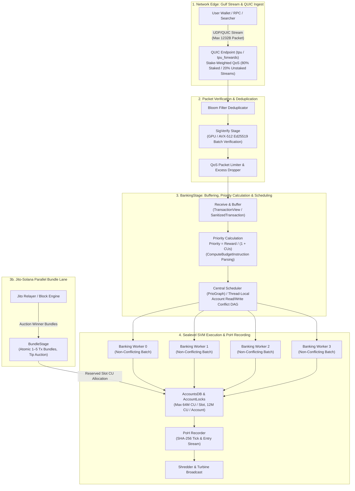
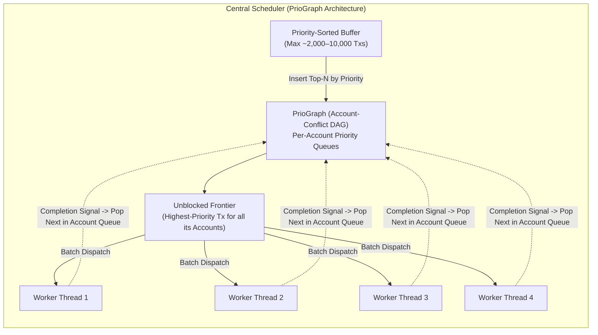

# Inside the Block: How Solana Validators Order Transactions

**Author:** Desu Sreecharan (`sreecharan-desu`)  
**Target Clients Reference:** Agave (`v2.1+` / `v2.2`), Jito-Solana, Firedancer (`fd_quic` / `fd_pack`)

---

## Executive Summary

Unlike Ethereum's 12-second slot cadence and global public mempool, a Solana leader has a **400-millisecond slot window** (four consecutive slots = 1.6 seconds per leader rotation) to ingest packets, verify Ed25519 signatures, resolve account read/write locks, schedule non-conflicting transactions across parallel execution threads, execute BPF/SBF bytecode inside the Sealevel virtual machine (SVM), append state transitions to the Proof-of-History (PoH) hash chain, and broadcast shreds via Turbine.

When an user clicks "Swap" or an arbitrage bot fires a transaction, **what actually determines where that transaction lands inside a block—or whether it gets dropped before ever reaching the scheduler?**

This deep dive traces a transaction's exact path through the validator pipeline—from **Gulf Stream** and **QUIC Stake-Weighted QoS (SWQoS)** at the network edge, into **SigVerify** and the **BankingStage Central Scheduler (`PrioGraph`)**, across **Sealevel account-lock queues**, and through the **Jito Block Engine / Bundle auction pipeline**.

---

## 1. End-to-End Validator Ingestion & Scheduling Pipeline

---

## 2. Gulf Stream, QUIC, and Stake-Weighted QoS (SWQoS)

### 2.1 Why Solana Replaced Raw UDP with QUIC
Historically, Solana's Transaction Processing Unit (`TPU`) accepted raw, connectionless UDP datagrams (up to the 1,232-byte IPv6 MTU limit). Because UDP provides no handshake, flow control, or source authentication at the transport layer, spam bots during NFT mints or volatile DeFi liquidations could flood the current leader's TPU socket with millions of spoofed packets per second, causing kernel ring-buffer drops before the validator could even inspect the transaction fee.

Solana replaced raw UDP on the TPU ingest port with **QUIC** (RFC 9000), giving the leader:
1. **Cryptographically authenticated session handshakes**: A validator can identify whether an incoming QUIC connection belongs to a staked validator identity keypair (`pubkey`) or an unstaked IP address.
2. **Per-connection stream throttling**: Each QUIC connection is rate-limited in concurrent streams and bytes/sec, preventing a single IP or rogue peer from monopolizing packet ingestion.

### 2.2 Stake-Weighted Quality of Service (SWQoS)
Under SWQoS, a leader partitions its incoming QUIC connection capacity and stream quotas into two buckets:
- **Staked Connections (~80% of stream capacity)**: Connections authenticated with a validator keypair holding active delegated stake (or staked RPC nodes peering via staked validator identities). The maximum number of concurrent QUIC streams per staked peer scales **proportionally to its fraction of total cluster stake**.
- **Unstaked Connections (~20% of stream capacity)**: Any public node or wallet sending directly to the leader's TPU port without stake backing.

**Implication for Transaction Ordering:**  
Before priority fees even enter the equation, **SWQoS acts as the first admission gate**. During congestion, a high-priority-fee transaction sent over an unstaked RPC connection can sit queued in a throttled QUIC stream or hit `MAX_STREAMS` backpressure while a lower-fee transaction forwarded through a high-stake RPC's SWQoS tunnel enters `SigVerify` immediately.

---

## 3. Packet Verification (`SigVerify`) and Zero-Copy `TransactionView`

Once QUIC reassembles a stream into a 1,232-byte `Packet`:
1. **Deduplication**: A rolling Bloom filter drops duplicate packet hashes (`blake3` / packet bytes) that arrived via both direct TPU and `tpu_forwards`.
2. **Batch Ed25519 Verification (`SigVerify`)**: Packets are grouped into batches and verified in parallel on GPU (if present) or AVX-512 CPU worker threads. Invalid packets are discarded immediately.
3. **Zero-Copy Parsing (`TransactionView` in Agave v2.0+)**: Rather than heap-allocating full `VersionedTransaction` structs for every incoming packet, Agave parses packet byte offsets in-place via `TransactionView` to extract:
   - Static account keys + Address Lookup Table (ALT) references
   - Read-only vs Writable account bitmasks
   - `ComputeBudget111111111111111111111111111111` instructions (`SetComputeUnitLimit` and `SetComputeUnitPrice`)

---

## 4. Priority Fees & How Validators Actually Rank Transactions

### 4.1 The Priority Formula inside Agave (`BankingStage`)
A common misconception among developers is that setting a higher total fee (or simply calling `SetComputeUnitPrice`) guarantees earlier inclusion regardless of compute unit (`CU`) limits.

In Agave's `CommitTransactionDetails` and `ComputeBudgetLimits`, priority is calculated per **requested** Compute Unit, not per consumed Compute Unit:

$$\text{Priority} = \frac{\text{Additional Fee (micro-lamports)}}{\text{Requested Compute Units}}$$

More precisely, Agave computes overall transaction reward and priority weight from:
1. **Base Fee**: $5,000\text{ lamports} \times N_{\text{signatures}}$
2. **Prioritization Fee**:
   $$\text{Prioritization Fee (lamports)} = \left\lceil \frac{\text{ComputeUnitPrice (\mu\text{-lamports/CU})} \times \text{ComputeUnitLimit}}{1,000,000} \right\rceil$$
3. **Scheduler Priority Score**:
   $$\text{Score} = \left\lfloor \frac{\text{Total Validator Reward (micro-lamports)}}{1 + \text{Estimated / Requested CUs}} \right\rfloor$$

### 4.2 Why Over-Requesting Compute Units Hurts Your Ordering
If a transaction does **not** include a `SetComputeUnitLimit` instruction, the runtime assigns a default budget of **200,000 CUs per top-level instruction** (capped at 1,400,000 CUs per transaction).

Suppose two traders submit the exact same Jupiter swap that actually consumes **85,000 CUs**, and both want to pay **0.001 SOL (1,000,000 lamports)** in priority fees:

| Trader | `SetComputeUnitLimit` | Actual CUs Used | Total Fee Paid | Effective Priority (`micro-lamports / CU`) | Scheduler Rank |
| :--- | :--- | :--- | :--- | :--- | :--- |
| **Trader A (Unoptimized)** | Omitted (Defaults to `600,000 CU` across 3 instructions) | `85,000 CU` | `1,005,000 lamports` | `~1,675,000` | **2nd (Lower)** |
| **Trader B (Tight CU Limit)** | Explicitly set to `90,000 CU` | `85,000 CU` | `1,005,000 lamports` | `~11,166,666` | **1st (6.6x Higher!)** |

Because the scheduler must reserve `ComputeUnitLimit` against the block's **60M–64M CU slot cap** and the **12M CU per-writable-account cap** *before* executing the transaction, it ranks transactions by **reward per reserved CU**.

---

## 5. Inside `BankingStage`: Central Scheduler (`PrioGraph`) vs Thread-Local Scheduling

### 5.1 Why Solana Needs Account-Lock Aware Scheduling
In Sealevel (SVM), every transaction declares all accounts it will read or write upfront in its header. Two transactions $T_1$ and $T_2$ can execute in parallel on separate CPU cores **if and only if**:
$$\left(W(T_1) \cap W(T_2) = \emptyset\right) \;\land\; \left(W(T_1) \cap R(T_2) = \emptyset\right) \;\land\; \left(R(T_1) \cap W(T_2) = \emptyset\right)$$
where $W(T)$ is the set of writable accounts and $R(T)$ is the set of read-only accounts.

### 5.2 Legacy Thread-Local Mode (`ConsumeWorker`) vs Central Scheduler (`PrioGraph`)
 Agave supports two scheduling architectures in `BankingStage`:

1. **Central Scheduler (`PrioGraph`)**:
   - A dedicated scheduler thread pops transactions from the incoming container in descending priority order and inserts them into a directed acyclic conflict graph (**`PrioGraph`**).
   - For every account $A$ touched by transaction $T_i$, $T_i$ is appended to $A$'s priority chain. If an earlier, higher-priority transaction $T_{\text{high}}$ already holds (or waits on) a conflicting lock on account $A$ (for instance, a hot Raydium AMM pool state account), $T_i$ has an incoming dependency edge $T_{\text{high}} \to T_i$ and **cannot be dispatched to a worker thread** until $T_{\text{high}}$ completes.
   - Meanwhile, a lower-priority transaction $T_{\text{low}}$ that touches **disjoint accounts** (e.g., transferring USDC between two cold wallets) has zero incoming dependency edges in `PrioGraph` and is dispatched **immediately** to an idle worker thread in parallel!

2. **Lookahead Window & Non-Conflicting Parallelism**:
   - Because `PrioGraph` only blocks transactions that conflict on shared accounts, **block ordering on Solana is fundamentally partial, not global**:
     - **Within the same hot account (e.g., SOL/USDC pool)**: Transactions are strictly ordered by descending priority (`reward / CU`), subject to arrival time within the scheduler lookahead window (`lookahead_size ≈ 2,048` transactions).
     - **Across disjoint accounts**: A low-fee transaction on an idle account will regularly land in an earlier PoH entry than a high-fee transaction queued behind 15 other swaps on a congested AMM pool.

---

## 6. Jito-Solana: How Bundles & the Block Engine Reshape Block Construction

Over 90% of Solana stake runs **Jito-Solana** (or Agave with Jito's MEV extensions). Jito introduces a deterministic, out-of-band auction mechanism Alongside the standard `BankingStage`:

1. **Jito Relayer & Block Engine**:
   - Searchers submit **Bundles** (an ordered list of up to 5 transactions that must execute sequentially and atomically—all succeed or none land) to the off-chain **Jito Block Engine**, including a tip transfer to one of the 8 official Jito Tip Payment accounts.
   - Simultaneously, the Jito Relayer forwards regular packet flow to the Block Engine so searchers can simulate backruns against pending transactions in a 200ms speed-bump window (where configured).
2. **Auction & `BundleStage`**:
   - The Block Engine simulates bundles and runs a continuous auction every ~50ms, forwarding the highest-tipping non-conflicting bundles over a dedicated gRPC stream to the validator's **`BundleStage`**.
   - Inside Jito-Solana, **80% of the slot's compute units (48M CUs)** are initially usable by standard `BankingStage` packets while **up to 20% of slot CUs (and dedicated PoH tick windows)** are prioritized for `BundleStage` execution.
   - Because `BundleStage` acquires account locks atomically for the entire bundle before committing to `AccountsDB` and the `PoHRecorder`, a winning Jito bundle bypasses `PrioGraph` contention on the public TPU path and lands in exact sequential order `[Tx_1, Tx_2, ..., Tx_k]`.

---

## 7. Account Compute Limits, Lock Contention, and Why High-Fee Transactions Still Fail or Drop

Even when a transaction pays a high priority fee or Jito tip, three protocol-level invariants govern whether it makes it into the block:

| Constraint | Protocol Limit | Ordering & Inclusion Impact |
| :--- | :--- | :--- |
| **Max Block Compute Units** | `60,000,000 CUs` (raised from 48M; moving toward 100M) | Once cumulative CUs in the slot hit the cap, all remaining transactions wait for the next slot. |
| **Max Writable Account CUs per Slot** | `12,000,000 CUs` per writable account | Even if the block is 75% empty, **no single writable account (e.g., a hot liquidity pool or mint state) can consume >12M CUs in one slot**. Once that account hits 12M CUs, every subsequent transaction writing to it is deferred or dropped. |
| **Max Account Locks per Transaction** | `64` accounts (expanding to `128` via SIMD) | Transactions exceeding the account lock limit fail sanitization before scheduling. |
| **Max Vote vs Non-Vote Split** | Up to `48M–50M CUs` non-vote | Consensus vote transactions have dedicated reservation so DeFi congestion cannot halt Tower BFT finality. |

---

## 8. Actionable Playbook for Solana Builders & Traders

To maximize deterministic inclusion and optimal position inside a Solana block:

1. **Always Simulate and Set Tight `SetComputeUnitLimit`**: Never rely on the 200,000 CU per-instruction default. Simulate the transaction via `simulateTransaction`, add a 10% safety margin, and prepend `ComputeBudgetProgram.setComputeUnitLimit({ units })` so your priority score ($\text{Fee} / \text{CU}$) is not diluted 3x–6x.
2. **Route Through SWQoS-Backed RPCs**: Because unstaked QUIC streams are capped at ~20% of TPU ingress capacity, broadcasting through a staked SWQoS connection prevents packet drops at the QUIC layer before `BankingStage` ever reads your `ComputeUnitPrice`.
3. **Eliminate Unnecessary Writable Flags**: Demote any account that does not mutate state (`readonly`) in your Anchor/Pinocchio instruction IDL. Every unnecessary `#[account(mut)]` forces `PrioGraph` to serialize your transaction behind all other writers to that account and counts against that account's 12M CU per-slot ceiling.
4. **Use Jito Bundles for Strict Multi-Transaction Atomicity, and Priority Fees for Latency-Sensitive Single Transactions**: Jito's Block Engine auction adds a small simulation/auction cadence (~50ms) in exchange for revert protection and strict multi-tx ordering; direct SWQoS + tight CU priority fees enter `BankingStage` continuously on every tick.
